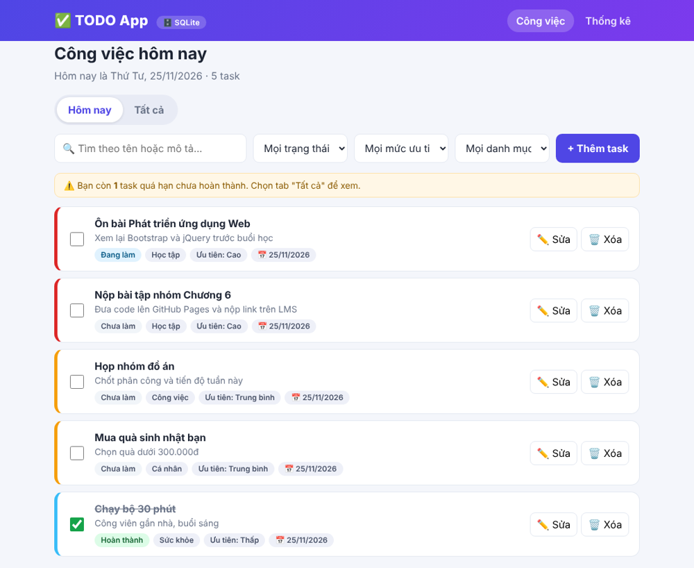
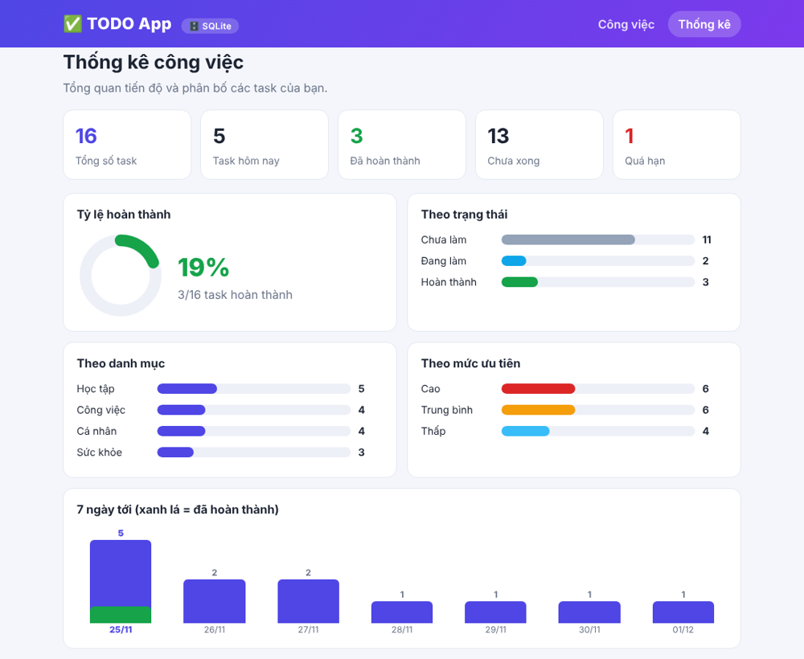

# TODO App – Quản lý công việc cá nhân

Ứng dụng web giúp quản lý các task cá nhân hằng ngày. Dự án thuộc môn **Phát triển ứng dụng WEB/TMĐT**.

- **Sinh viên:** Nguyễn Phúc Thảo Nguyên – MSSV 31221023069
- **Demo (GitHub Pages):** https://tn063167-lab.github.io/Tuan3-Venha/TodoApp/
- **Công nghệ:** HTML, CSS, JavaScript thuần (không dùng thư viện ngoài); Python + SQLite cho bản có cơ sở dữ liệu.

## Chức năng

1. **Hiển thị task trong ngày hôm nay** (tab "Hôm nay"), có tab "Tất cả" để xem mọi task.
   - **Tìm kiếm** theo tên hoặc mô tả.
   - **Lọc** theo trạng thái (Chưa làm / Đang làm / Hoàn thành), mức ưu tiên (Cao / Trung bình / Thấp) và danh mục (Học tập / Công việc / Cá nhân / Sức khỏe).
   - Cảnh báo số task **quá hạn**; tick ô vuông để đánh dấu hoàn thành.
2. **Thêm – Sửa – Xóa task** bằng form popup, có kiểm tra dữ liệu (bắt buộc nhập tên và ngày).
3. **Trang thống kê:** tổng số task, task hôm nay, đã hoàn thành, quá hạn, tỷ lệ hoàn thành (biểu đồ tròn), thống kê theo trạng thái / danh mục / ưu tiên và biểu đồ cột 7 ngày tới.
4. **Dữ liệu mock:** 16 task mẫu có sẵn, ngày được tính theo hôm nay nên luôn có task trong ngày. Nút "Nạp dữ liệu mẫu" và "Xóa tất cả" ở cuối trang.

## Hai chế độ chạy (cùng một giao diện)

| Chế độ | Cách chạy | Nơi lưu dữ liệu |
|---|---|---|
| **Không có CSDL** | Mở `index.html` hoặc dùng GitHub Pages | `localStorage` của trình duyệt |
| **Có CSDL SQLite** | `python server.py` rồi mở http://localhost:8000 | File `todo.db` (SQLite) |

Giao diện tự nhận biết chế độ: nếu gọi được `api/tasks` thì dùng SQLite, ngược lại dùng `localStorage`. Góc trên có nhãn cho biết đang ở chế độ nào.

## Cấu trúc thư mục

```
TodoApp/
├── index.html          # Trang công việc (danh sách, tìm kiếm, lọc, thêm/sửa/xóa)
├── stats.html          # Trang thống kê
├── css/style.css       # Giao diện (responsive)
├── js/storage.js       # Lớp lưu trữ: SQLite (API) hoặc localStorage
├── js/app.js           # Logic trang công việc
├── js/stats.js         # Logic trang thống kê
├── data/               # Dữ liệu mock (mock-tasks.json cho server, mock-data.js cho trình duyệt)
├── server.py           # Server Python + API REST + SQLite
├── schema.sql          # Cấu trúc bảng tasks
├── PROMPTS.md          # Prompt dùng để vibe code
└── images/             # Ảnh chụp màn hình
```

## API (khi chạy `server.py`)

| Phương thức | Đường dẫn | Mô tả |
|---|---|---|
| GET | `/api/tasks` | Lấy danh sách task |
| POST | `/api/tasks` | Thêm task |
| PUT | `/api/tasks/<id>` | Sửa task |
| DELETE | `/api/tasks/<id>` | Xóa task |
| POST | `/api/seed` / `/api/clear` | Nạp dữ liệu mẫu / xóa tất cả |

Bảng `tasks`: `id`, `title`, `description`, `category`, `priority`, `due` (YYYY-MM-DD), `status`, `created_at` (xem `schema.sql`).

## Cách chạy

**Bản không CSDL:** giải nén và bấm đúp `index.html` (hoặc dùng Live Server của VS Code).

**Bản có CSDL:** cần Python 3 (không cần cài thêm thư viện).
```bash
cd TodoApp
python server.py        # mặc định cổng 8000, hoặc: python server.py 9000
```
Mở http://localhost:8000. File `todo.db` được tạo tự động ở lần chạy đầu tiên cùng dữ liệu mẫu.

## Đưa lên GitHub Pages

Upload thư mục `TodoApp` vào repository, vào **Settings → Pages → Deploy from a branch → main / (root)**. Trang Pages chạy bản không CSDL (lưu bằng `localStorage`) vì GitHub Pages chỉ phục vụ file tĩnh.

## Ảnh chụp màn hình

| Trang công việc | Trang thống kê |
|---|---|
|  |  |
